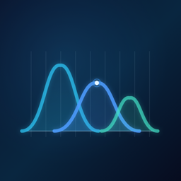

<p align="center">
  
</p>

<h1 align="center">AetherScan</h1>

<p align="center">
  <strong>The Spectral Wi-Fi Inspector for macOS</strong><br>
  Um aplicativo nativo para inspecionar redes Wi-Fi próximas, entender a ocupação dos canais e encontrar opções de configuração mais adequadas.
</p>

<p align="center">
  
  
  
  
</p>

> [!IMPORTANT]
> **O AetherScan não é um analisador de espectro de RF.** Ele utiliza as informações de redes Wi-Fi disponibilizadas pelo macOS por meio do CoreWLAN. A classificação dos canais e as recomendações são **estimativas**, não medições diretas de interferência eletromagnética.

## Visão geral

O **AetherScan** foi criado para facilitar o diagnóstico básico de ambientes Wi-Fi no Mac. Em vez de apresentar apenas uma lista de redes, o aplicativo reúne os parâmetros disponíveis de cada ponto de acesso, identifica a rede à qual o computador está conectado e ajuda a responder perguntas práticas:

- Quais redes estão ao alcance do meu Mac?
- Em qual canal e faixa de frequência cada rede opera?
- Existem outras redes utilizando o mesmo canal?
- Há indícios de sobreposição entre canais de 2,4 GHz?
- Qual canal de 2,4 GHz ou 5 GHz parece menos ocupado **entre as redes detectadas nesta varredura**?

Tudo isso em uma interface nativa, com suporte a **português brasileiro e inglês**, seguindo o idioma do sistema.

## Funcionalidades

| Recurso | O que faz |
| --- | --- |
| **Varredura de redes próximas** | Consulta a interface Wi-Fi do Mac e apresenta os pontos de acesso encontrados. |
| **Identificação da conexão atual** | Destaca a rede em uso e, quando disponíveis, mostra seu canal, faixa, largura de canal e sinal. |
| **Detalhamento das redes** | Exibe SSID, BSSID, canal, frequência calculada, largura de canal e intensidade do sinal (RSSI). |
| **Filtros rápidos** | Permite visualizar todas as redes, apenas 2,4 GHz, 5 GHz, 6 GHz ou somente a rede atual. |
| **Saúde do canal** | Classifica condições como canal livre, canal compartilhado, sobreposição ou informação indisponível, a partir de regras heurísticas. |
| **Sugestão para 2,4 GHz** | Compara os canais **1, 6 e 11** e seleciona aquele com menor carga estimada entre as redes observadas. |
| **Sugestão para 5 GHz** | Compara canais de 5 GHz informados como compatíveis com a interface Wi-Fi do Mac e sugere o de menor carga estimada. |
| **Atualização manual** | Inicia nova varredura pelo botão **Atualizar** ou pelo atalho **⌘R**. |
| **Estados e permissões** | Mostra orientações quando a localização não foi autorizada, a interface está indisponível ou a varredura falha. |
| **Interface macOS** | Utiliza tabelas, materiais translúcidos, elementos acessíveis e adaptação à aparência clara/escura do sistema. |

**Sobre 6 GHz:** o aplicativo possui identificação e filtro para essa faixa quando o hardware, o macOS e o CoreWLAN disponibilizam as informações. **Não há recomendação automática de canais de 6 GHz** na implementação atual.

## Como a análise funciona

1. O **CoreLocation** solicita autorização para acesso à Localização, necessária no macOS para disponibilizar determinados identificadores de redes Wi-Fi.
2. O **CoreWLAN** consulta a interface Wi-Fi local, executa uma varredura e obtém os atributos expostos pelo sistema.
3. O AetherScan organiza os resultados, destaca a conexão atual e mostra a intensidade do sinal em **dBm (RSSI)**.
4. As regras de diagnóstico verificam compartilhamento de canal e possíveis sobreposições em **2,4 GHz**.
5. Um cálculo heurístico considera a proximidade entre frequências, a largura dos canais e a potência relativa dos sinais observados para estimar a carga dos canais candidatos.

### Interpretando os indicadores

| Indicador | Significado na interface |
| --- | --- |
| **Livre** | Não foi identificado um conflito pelas regras aplicadas à rede e às demais redes visíveis. **Não** significa ausência garantida de interferência. |
| **Canal compartilhado** | Outra rede detectada usa o mesmo canal. |
| **Sobreposição** | A configuração em 2,4 GHz ou a proximidade entre canais indica potencial sobreposição. |
| **Indisponível** | Faltam informações suficientes para calcular o indicador. |

A apresentação do RSSI segue os intervalos usados pela interface: **verde** a partir de -60 dBm, **laranja** de -75 até -61 dBm e **vermelho** abaixo de -75 dBm. Esses intervalos são referências visuais do aplicativo, não um teste de qualidade ou desempenho da conexão.

> **Importante:** a frequência exibida é obtida a partir do número do canal e da faixa, e não de uma medição de espectro. Uma recomendação melhor na varredura pode não ser a melhor escolha em todos os horários ou condições de uso.

## Requisitos

- **macOS 13 Ventura ou posterior**.
- Um **Mac com interface Wi-Fi** disponível e Wi-Fi habilitado.
- **Xcode** instalado e configurado para compilar o projeto, com SDK macOS compatível. O projeto é um aplicativo Xcode nativo, portanto apenas as Command Line Tools podem não ser suficientes.
- Autorização de **Serviços de Localização** para que o macOS disponibilize nomes e identificadores de redes.

Os dados encontrados dependem do adaptador Wi-Fi, da versão do sistema, da região regulatória, das permissões concedidas e do comportamento do CoreWLAN.

## Instalação e execução

### Opção 1: pelo Terminal

Clone o repositório e execute o aplicativo:

```bash
git clone https://github.com/gabrielpgava/AetherScan.git
cd AetherScan
make run
```

O comando `make run` compila a configuração **Debug** e abre o `AetherScan.app` gerado.

Outros comandos disponíveis:

| Comando | Finalidade |
| --- | --- |
| `make` ou `make build` | Compila a configuração escolhida, por padrão **Debug**. |
| `make debug` | Compila a versão Debug. |
| `make release` | Compila a versão Release. |
| `make run` | Compila Debug e abre o aplicativo. |
| `make xcode` | Abre o projeto no Xcode. |
| `make icon` | Regenera o ícone e as resoluções de imagem a partir do script Swift. |
| `make clean` | Limpa os produtos de compilação Debug e Release. |
| `make help` | Exibe as opções de compilação. |

As compilações ficam em `build/DerivedData/Build/Products/Debug/` e `build/DerivedData/Build/Products/Release/`.

É possível personalizar variáveis do Makefile, por exemplo:

```bash
make build CONFIGURATION=Release DESTINATION="platform=macOS,arch=arm64"
```

### Opção 2: pelo Xcode

1. Abra `AetherScan.xcodeproj`.
2. Selecione o scheme **AetherScan** e o destino **My Mac**.
3. Execute pelo botão **Run** ou pressione **⌘R** no Xcode.
4. Na primeira abertura, conceda o acesso aos **Serviços de Localização** quando solicitado.

> O projeto usa configuração de assinatura voltada à compilação local. Criar um pacote destinado a terceiros pode exigir configurar a identidade de assinatura, a distribuição e a notarização da Apple.

## Como usar

1. **Abra o aplicativo.** A primeira varredura começa automaticamente.
2. **Autorize a Localização**, se solicitada. Isso permite ao macOS expor informações como SSIDs e BSSIDs.
3. **Confira sua conexão atual** no cartão superior, quando ela estiver disponível.
4. **Explore a tabela** de redes e filtre por faixa ou selecione **Minha rede**.
5. **Observe a saúde dos canais** para identificar possíveis disputas ou sobreposições.
6. **Consulte os canais recomendados** de 2,4 GHz e 5 GHz. A indicação é uma estimativa baseada no ambiente visível naquele momento.
7. Pressione **Atualizar** ou **⌘R** para obter uma nova leitura.

### Se a varredura não funcionar

- **Permissão negada:** abra **Ajustes do Sistema → Privacidade e Segurança → Serviços de Localização**, autorize o AetherScan e retorne ao aplicativo.
- **Acesso restrito:** verifique as políticas e os ajustes de segurança do Mac.
- **Nenhuma interface encontrada:** ative o Wi-Fi e confira se existe uma interface disponível.
- **Nenhuma rede listada ou dados incompletos:** revise a autorização, a disponibilidade do Wi-Fi e as limitações do hardware ou do macOS; depois, execute outra varredura.
- **Erro de compilação:** confirme que o Xcode completo está instalado e selecionado para o `xcodebuild`.

## Estrutura do projeto

```text
AetherScan/
├── AetherScan.xcodeproj/          # Projeto Xcode
├── AetherScan/
│   ├── App/                       # Inicialização e janelas
│   ├── Models/                    # Redes, faixas e regras de análise
│   ├── Services/                  # Varredura Wi-Fi e autorização
│   ├── ViewModels/                # Estado e fluxo da varredura
│   ├── Views/                     # Interface, indicadores e tela Sobre
│   ├── Support/                   # Localização dos textos da interface
│   ├── Assets.xcassets/           # Ícones e recursos visuais
│   ├── en.lproj/                  # Textos em inglês
│   ├── pt-BR.lproj/               # Textos em português
│   └── Info.plist                 # Metadados e descrição da permissão
├── Scripts/                       # Geração de ícones
├── Makefile                       # Atalhos de compilação e execução
├── PRODUCT.md                     # Definição e diretrizes do produto
└── README.md
```

### Tecnologias

- **Swift e SwiftUI:** interface gráfica e ciclo de vida do aplicativo.
- **CoreWLAN:** consulta da interface Wi-Fi e leitura das redes próximas.
- **CoreLocation:** gerenciamento da autorização de Localização.
- **AppKit:** integração com funcionalidades nativas do macOS.
- **Foundation e Combine:** estruturas de dados, estado e eventos.

O aplicativo **não utiliza dependências de terceiros** na implementação disponível neste repositório.

## Privacidade e funcionamento local

O AetherScan foi projetado para realizar a análise **no próprio Mac**. O código atual utiliza as informações fornecidas pelos frameworks do macOS e não implementa backend, telemetria, login, integração com nuvem ou envio de resultados a servidores externos.

A autorização de Localização é solicitada porque o **macOS a exige para revelar informações de redes Wi-Fi**, não para apresentar um mapa ou rastrear o deslocamento do usuário. O aplicativo não solicita coordenadas de localização para sua análise.

## Limitações e escopo

Para interpretar os resultados corretamente:

- A varredura detecta **redes Wi-Fi acessíveis à interface do Mac**, não todas as fontes de radiofrequência presentes no ambiente.
- O aplicativo **não mede ruído de RF, interferência não Wi-Fi, ocupação temporal real do canal, throughput ou latência**.
- Os diagnósticos e as sugestões de canais são **heurísticas** baseadas na varredura disponível, e não garantias de melhor desempenho.
- A disponibilidade de **SSID, BSSID, RSSI, largura de canal e faixas** varia conforme hardware, sistema, região e permissão.
- **Não existe varredura contínua ou histórico persistente** na implementação atual. Novas leituras são solicitadas manualmente após a primeira varredura.
- O aplicativo **não modifica a configuração do roteador**, não se conecta a novas redes e não executa auditorias de senhas ou segurança.
- As recomendações automáticas cobrem **2,4 GHz e 5 GHz**, não 6 GHz.

## Desenvolvimento e colaboração

O código está organizado em camadas de interface, estado, serviços e modelos para facilitar a evolução da aplicação. Para propor melhorias ou relatar problemas, utilize as [Issues](https://github.com/gabrielpgava/AetherScan/issues) e os [Pull Requests](https://github.com/gabrielpgava/AetherScan/pulls) do repositório.

**Licença:** até o momento, não há um arquivo `LICENSE` neste repositório. A disponibilização pública do código não implica automaticamente autorização de redistribuição ou reutilização; consulte os responsáveis antes de utilizá-lo em outro projeto.

## Créditos

**AetherScan** é desenvolvido pela **[Ideal Opposite](https://www.idealopposite.com)**, com foco em uma experiência de inspeção de Wi-Fi simples, local e integrada ao macOS.

<sub>Documentação baseada nas funcionalidades presentes no código-fonte do repositório.</sub>
